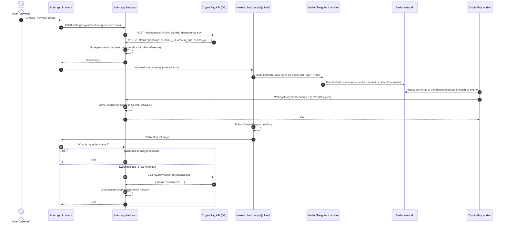
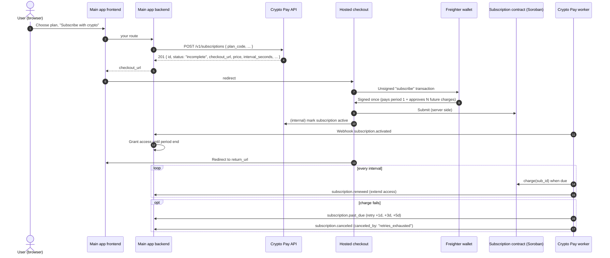

# StelPay: Integration Guide for the Main App

This guide is for the developer who connects an app (its backend and web frontend) to the crypto payment service in this repo. You do not need to read the rest of the repo. Everything here is taken from the code; file references are given so you can check them.

If you already integrated MoMo, the shape is the same: create a payment on the server, send the user to a hosted page, wait for a signed callback, then grant access. Crypto is just one more provider adapter.

---

## Contents

1. [Overview](#1-overview)
2. [Environments and what you need](#2-environments-and-what-you-need)
3. [Authentication (request signing)](#3-authentication-request-signing)
4. [Idempotency](#4-idempotency)
5. [Endpoint reference](#5-endpoint-reference)
6. [Hosted checkout](#6-hosted-checkout)
7. [Webhooks](#7-webhooks)
8. [Access rules for the main app](#8-access-rules-for-the-main-app)
9. [Amounts and currencies](#9-amounts-and-currencies)
10. [Errors, rate limits, timeouts and retries](#10-errors-rate-limits-timeouts-and-retries)
11. [Testing on testnet](#11-testing-on-testnet)
12. [Go-live checklist](#12-go-live-checklist)
13. [Known gaps and code/spec differences](#13-known-gaps-and-codespec-differences)

---

## 1. Overview

The service lets RodiumAi take **USDC on the Stellar network** for:

- **One-time payments.** You ask for a fiat amount (for example 19.99 USD). The service converts it to USDC, locks that quote for a short time (default 20 minutes), and gives you a checkout link. The user pays from their own wallet. When the money arrives on-chain, you get a `payment.confirmed` webhook.
- **Subscriptions.** You ask for a plan by code (for example `pro_monthly`). The user signs once in their wallet. That signature pays the first period and approves a limited number of future charges. The service charges each period automatically and tells you with webhooks (`subscription.activated`, `subscription.renewed`, `subscription.past_due`, `subscription.canceled`).

The main app never touches wallets, keys or blockchain code. It does three things:

1. Calls the service's API (`/v1/...`), signed with HMAC-SHA256.
2. Redirects the user's browser to the `checkout_url` the API returns.
3. Receives webhooks (signed with Ed25519) and grants or revokes access.

### 1.1 One-time payment flow



### 1.2 Subscription flow



---

## 2. Environments and what you need

### 2.1 Environments

| Environment | Stellar network | Network passphrase (`packages/config/src/network.ts`) | USDC issuer                                                |
| ----------- | --------------- | ----------------------------------------------------- | ---------------------------------------------------------- |
| Staging     | `testnet`       | `Test SDF Network ; September 2015`                   | `GBBD47IF6LWK7P7MDEVSCWR7DPUWV3NY3DTQEVFL4NAT4AQH3ZLLFLA5` |
| Production  | `mainnet`       | `Public Global Stellar Network ; September 2015`      | `GA5ZSEJYB37JRC5AVCIA5MOP4RHTM335X2KGX3IHOJAPP5RE34K4KZVN` |

Base URLs come from the deployment, not from this repo. Use placeholders in your config and get the real values from whoever runs the service:

| Placeholder       | What it is                                                                                                                                           |
| ----------------- | ---------------------------------------------------------------------------------------------------------------------------------------------------- |
| `RP_API_BASE_URL` | Where your backend reaches `/v1/...`. Private network only; never call it from the browser.                                                          |
| Checkout base     | Public `https://pay.<domain>`. You never build checkout URLs yourself: always use `checkout_url` from the API (service setting `CHECKOUT_BASE_URL`). |

The same API process serves `/v1/*` (your backend), `/c/*` (users' browsers) and `/health/live`.

### 2.2 What the main app must have

Get these through your secret store. **Never paste secrets in chat, tickets, or source code.**

| Item                            | Format                                                 | Where it comes from (service side)                                                                                        |
| ------------------------------- | ------------------------------------------------------ | ------------------------------------------------------------------------------------------------------------------------- |
| API key id                      | `ak_[a-z0-9_]{1,32}`, e.g. `ak_2026_10`                | One entry of `API_HMAC_KEYS` (`id:secret,id:secret`, at most 2), see `apps/api/src/api-config.ts`                         |
| API key secret (**secret**)     | base64url (no padding), decodes to at least 32 bytes   | Same entry of `API_HMAC_KEYS`                                                                                             |
| Webhook public key(s)           | Ed25519 public key, PEM (`-----BEGIN PUBLIC KEY-----`) | `openssl pkey -in whk.pem -pubout` from the worker's `WEBHOOK_SIGNING_KEY_PEM` (`docs/runbooks/rotation.md`). Not secret. |
| Webhook key id                  | `[A-Za-z0-9_-]{1,64}`, convention `whk_<yyyy_mm>`      | Worker setting `WEBHOOK_SIGNING_KEY_ID`                                                                                   |
| Plan codes (subscriptions only) | `[a-z0-9_]{1,64}`, e.g. `pro_monthly`                  | Service setting `SUBSCRIPTION_PLANS`                                                                                      |
| Accepted fiat currencies        | ISO 4217 codes, e.g. `USD,GHS`                         | Service setting `FX_SUPPORTED_FIAT`                                                                                       |

What the service team needs from you:

| Item                      | Service setting        | Rules                                                                                                                             |
| ------------------------- | ---------------------- | --------------------------------------------------------------------------------------------------------------------------------- |
| Your webhook URL          | `WEBHOOK_URL` (worker) | One URL per deployment. Must be `https://` when the worker runs with `NODE_ENV=production` (staging does too). Must not redirect. |
| Your return-URL origin(s) | `RETURN_URL_ORIGINS`   | Bare origins only: `scheme://host[:port]`, comma-separated, e.g. `https://app.rodiumai.example`.                                  |
| Your egress IPs / network | (infra)                | The API is meant to be reachable only from your network. Context §12.1 asks for mTLS; see the note below.                         |

Suggested main-app environment variables (names are yours to choose):

```bash
RP_API_BASE_URL=https://rp-api.internal.example     # placeholder
RP_API_KEY_ID=ak_2026_10
RP_API_KEY_SECRET=<from secret store>                 # base64url
RP_WEBHOOK_PUBLIC_KEYS='{"whk_2026_10":"-----BEGIN PUBLIC KEY-----\n...\n-----END PUBLIC KEY-----\n"}'
CRYPTO_PAY_ENABLED=false                               # feature flag, default OFF
```

> **mTLS note.** `docs/context.md` §9 and §12.1 say the main app reaches the API over mTLS. This repo does not implement client-certificate checks in the API: TLS terminates at the ingress controller (`infra/k8s/base/network-policies.yaml`). If ops enable client certificates at the ingress, they will give you a client cert/key to configure in your HTTP agent. HMAC signing is required either way.

---

## 3. Authentication (request signing)

Every `/v1/*` request **except** `/v1/health/*` must be signed (`apps/api/src/server.ts`). Source of truth: `packages/security/src/hmac-auth.ts`.

### 3.1 Headers

| Header            | Value                                                                                                     |
| ----------------- | --------------------------------------------------------------------------------------------------------- |
| `X-RP-Key-Id`     | Your key id, e.g. `ak_2026_10`                                                                            |
| `X-RP-Timestamp`  | Unix time in **seconds**, decimal, no leading zero (regex `^[1-9][0-9]{0,11}$`)                           |
| `X-RP-Nonce`      | 16 random bytes (or more), base64url **without padding** → at least 22 characters. New for every request. |
| `X-RP-Signature`  | base64url (no padding) of HMAC-SHA256(secret, canonical string)                                           |
| `Content-Type`    | `application/json` on requests with a body. Any other type returns `415 unsupported_media_type`.          |
| `Idempotency-Key` | Required on `POST /v1/payments` and `POST /v1/subscriptions` (see §4)                                     |

Header names are case-insensitive.

### 3.2 Canonical string

Five lines joined with `\n` (LF, no trailing newline):

```
METHOD            e.g. POST (upper case)
PATH_WITH_QUERY   exactly what the server sees as the URL, e.g. /v1/payments  (no host, no scheme)
TIMESTAMP         the X-RP-Timestamp value
NONCE             the X-RP-Nonce value
BODY_SHA256_HEX   lower-case hex SHA-256 of the exact body bytes sent (empty body → hash of zero bytes)
```

The empty-body hash is `e3b0c44298fc1c149afbf4c8996fb92427ae41e4649b934ca495991b7852b855` (used for `GET`).

### 3.3 What the server checks, in order

1. All four `X-RP-*` headers present.
2. Timestamp format valid, and `|server_now - timestamp| <= 300` seconds (`MAX_CLOCK_SKEW_SECONDS`). Keep your servers on NTP.
3. Nonce is canonical base64url and decodes to ≥ 16 bytes.
4. Key id is known (one of at most two active keys).
5. Signature matches (constant-time compare).
6. Nonce not seen before for this key. Nonces are remembered for **600 seconds** (`NONCE_TTL_SECONDS`) in Redis. If Redis is down, requests fail closed with `503 service_unavailable`.
7. Rate limit: 120 requests per minute per key id (§10.2).

Any failure in 1–6 returns exactly:

```http
HTTP/1.1 401
{"error":{"code":"unauthorized","message":"Unauthorized"}}
```

The reason is only in the service's logs, never in the response.

Note the order inside the server: the body is parsed (size and content type) **before** authentication. So a wrong `Content-Type` gives `415` and a body over 16 KB gives `413` even if the signature is wrong.

### 3.4 TypeScript client (Node.js, node:crypto only)

Drop this into your backend, e.g. `src/payments/crypto/rodium-pay.client.ts`. It needs Node 18+ (global `fetch`). It signs, retries safely and keeps the same body bytes and Idempotency-Key across retries.

```ts
import { createHash, createHmac, randomBytes } from 'node:crypto';

export interface RodiumPayConfig {
  /** e.g. https://rp-api.internal.example, no trailing slash needed */
  readonly baseUrl: string;
  readonly keyId: string;
  /** base64url secret from the secret store */
  readonly secretBase64Url: string;
  /** Per-attempt timeout. */
  readonly timeoutMs?: number;
  /** Total attempts for retryable failures (429, 500, 503, network errors). */
  readonly maxAttempts?: number;
}

export type RpErrorCode =
  | 'validation_failed'
  | 'unauthorized'
  | 'payment_not_found'
  | 'subscription_not_found'
  | 'idempotency_key_required'
  | 'idempotency_conflict'
  | 'payload_too_large'
  | 'unsupported_media_type'
  | 'unsupported_currency'
  | 'amount_exceeds_limit'
  | 'invalid_return_url'
  | 'unknown_plan'
  | 'country_not_allowed'
  | 'invalid_state'
  | 'rate_limited'
  | 'fx_unavailable'
  | 'service_unavailable'
  | 'not_found'
  | 'internal_error';

export class RodiumPayError extends Error {
  constructor(
    readonly status: number,
    readonly code: RpErrorCode | 'network_error' | 'bad_response',
    message: string,
    readonly retryAfterSeconds: number | null = null,
  ) {
    super(message);
  }

  get retryable(): boolean {
    return (
      this.status === 429 ||
      this.status === 500 ||
      this.status === 503 ||
      this.code === 'network_error'
    );
  }
}

const EMPTY = Buffer.alloc(0);

/** Builds the four X-RP-* headers for one attempt (context §9.1). */
export function signRodiumPayRequest(
  keyId: string,
  secret: Buffer,
  method: string,
  pathWithQuery: string,
  body: Buffer,
  nowSeconds: number = Math.floor(Date.now() / 1000),
): Record<string, string> {
  const timestamp = String(nowSeconds);
  const nonce = randomBytes(16).toString('base64url');
  const bodyHash = createHash('sha256').update(body).digest('hex');
  const canonical = [method.toUpperCase(), pathWithQuery, timestamp, nonce, bodyHash].join('\n');
  const signature = createHmac('sha256', secret).update(canonical).digest('base64url');
  return {
    'x-rp-key-id': keyId,
    'x-rp-timestamp': timestamp,
    'x-rp-nonce': nonce,
    'x-rp-signature': signature,
  };
}

const sleep = (ms: number): Promise<void> => new Promise((r) => setTimeout(r, ms));

export class RodiumPayClient {
  private readonly baseUrl: string;
  private readonly secret: Buffer;
  private readonly timeoutMs: number;
  private readonly maxAttempts: number;

  constructor(private readonly config: RodiumPayConfig) {
    this.baseUrl = config.baseUrl.replace(/\/+$/, '');
    this.secret = Buffer.from(config.secretBase64Url, 'base64url');
    if (this.secret.length < 32) throw new Error('RP API secret must decode to >= 32 bytes');
    this.timeoutMs = config.timeoutMs ?? 15_000;
    this.maxAttempts = config.maxAttempts ?? 4;
  }

  createPayment(input: CreatePaymentInput, idempotencyKey: string): Promise<PaymentWithCheckout> {
    return this.request<PaymentWithCheckout>('POST', '/v1/payments', input, idempotencyKey);
  }

  getPayment(id: string): Promise<Payment> {
    return this.request<Payment>('GET', `/v1/payments/${encodeURIComponent(id)}`);
  }

  createSubscription(
    input: CreateSubscriptionInput,
    idempotencyKey: string,
  ): Promise<SubscriptionWithCheckout> {
    return this.request<SubscriptionWithCheckout>(
      'POST',
      '/v1/subscriptions',
      input,
      idempotencyKey,
    );
  }

  getSubscription(id: string): Promise<Subscription> {
    return this.request<Subscription>('GET', `/v1/subscriptions/${encodeURIComponent(id)}`);
  }

  /** Idempotent on the server: canceling a canceled subscription returns 200. */
  cancelSubscription(id: string): Promise<Subscription> {
    return this.request<Subscription>(
      'POST',
      `/v1/subscriptions/${encodeURIComponent(id)}/cancel`,
      {},
    );
  }

  /** Unauthenticated. true only when the service answers 200 { status: "ready" }. */
  async isReady(): Promise<boolean> {
    try {
      const res = await fetch(`${this.baseUrl}/v1/health/ready`, {
        signal: AbortSignal.timeout(5_000),
      });
      return res.status === 200;
    } catch {
      return false;
    }
  }

  private async request<T>(
    method: 'GET' | 'POST',
    path: string,
    body?: unknown,
    idempotencyKey?: string,
  ): Promise<T> {
    // Serialize ONCE: retries must send byte-identical bodies (the idempotency hash covers them).
    const raw = body === undefined ? EMPTY : Buffer.from(JSON.stringify(body), 'utf8');
    let lastError: RodiumPayError | null = null;

    for (let attempt = 1; attempt <= this.maxAttempts; attempt++) {
      // Re-sign every attempt: a nonce is single-use and the timestamp must be fresh.
      const headers: Record<string, string> = signRodiumPayRequest(
        this.config.keyId,
        this.secret,
        method,
        path,
        raw,
      );
      if (body !== undefined) headers['content-type'] = 'application/json';
      if (idempotencyKey !== undefined) headers['idempotency-key'] = idempotencyKey;

      try {
        const res = await fetch(`${this.baseUrl}${path}`, {
          method,
          headers,
          ...(body === undefined ? {} : { body: raw }),
          signal: AbortSignal.timeout(this.timeoutMs),
        });
        const text = await res.text();
        if (res.ok) return JSON.parse(text) as T;
        lastError = toError(res.status, text, res.headers.get('retry-after'));
      } catch (error) {
        lastError = new RodiumPayError(
          0,
          'network_error',
          error instanceof Error ? error.message : 'network error',
        );
      }

      if (!lastError.retryable || attempt === this.maxAttempts) break;
      const backoffMs =
        lastError.retryAfterSeconds !== null
          ? lastError.retryAfterSeconds * 1000
          : Math.min(8_000, 500 * 2 ** (attempt - 1)) + Math.floor(Math.random() * 250);
      await sleep(backoffMs);
    }
    throw lastError ?? new RodiumPayError(0, 'network_error', 'request failed');
  }
}

function toError(status: number, text: string, retryAfter: string | null): RodiumPayError {
  let code: RodiumPayError['code'] = 'bad_response';
  let message = `HTTP ${String(status)}`;
  try {
    const parsed = JSON.parse(text) as { error?: { code?: string; message?: string } };
    if (parsed.error?.code !== undefined) code = parsed.error.code as RpErrorCode;
    if (parsed.error?.message !== undefined) message = parsed.error.message;
  } catch {
    // non-JSON body (e.g. a proxy error page)
  }
  const seconds = retryAfter !== null && /^\d+$/.test(retryAfter) ? Number(retryAfter) : null;
  return new RodiumPayError(status, code, message, seconds);
}

// ── Request and response types (copied from apps/api/src/routes/*.ts) ─────────

export interface CreatePaymentInput {
  /** 1–128 chars. Your order id. Not unique on the service side. */
  readonly merchant_order_id: string;
  /** 1–256 chars. Your opaque user id. Encrypted at rest, never returned. */
  readonly customer_ref: string;
  /** 1–140 chars. Shown to the user on the checkout page. */
  readonly description: string;
  readonly amount: {
    /** ISO 4217, upper case, must be in FX_SUPPORTED_FIAT */
    readonly currency: string;
    /** Positive integer in the currency's minor unit (cents for USD) */
    readonly value_minor: number;
  };
  /** <= 2048 chars; origin must be in RETURN_URL_ORIGINS */
  readonly return_url: string;
}

export type PaymentStatus =
  'pending' | 'underpaid' | 'confirmed' | 'expired' | 'late_paid' | 'refunded';

export interface UsdcAmount {
  readonly asset: string; // "USDC"
  /** Always exactly 7 decimals, e.g. "19.9900000" */
  readonly value: string;
}

export interface Payment {
  readonly id: string; // UUIDv7
  readonly status: PaymentStatus;
  readonly merchant_order_id: string;
  readonly amount_due: UsdcAmount;
  readonly amount_received: UsdcAmount;
  readonly fiat: {
    readonly currency: string;
    readonly value_minor: number;
    /** Fiat units per 1 USDC, 18 decimals, e.g. "1.000000000000000000" */
    readonly fx_rate: string;
  };
  readonly expires_at: string; // ISO 8601 with milliseconds, UTC
  readonly confirmed_at: string | null;
  readonly created_at: string;
}

export interface PaymentWithCheckout extends Payment {
  readonly checkout_url: string;
}

export interface CreateSubscriptionInput {
  /** 1–128 chars. Your subscription/plan-assignment id. */
  readonly merchant_subscription_ref: string;
  /** 1–256 chars. Your opaque user id. */
  readonly customer_ref: string;
  /** 1–64 chars. Must match a configured plan. */
  readonly plan_code: string;
  readonly return_url: string;
}

export type SubscriptionStatus = 'incomplete' | 'active' | 'past_due' | 'canceled';

export interface Subscription {
  readonly id: string;
  readonly status: SubscriptionStatus;
  readonly merchant_subscription_ref: string;
  readonly plan_code: string;
  readonly price: UsdcAmount;
  readonly interval_seconds: number;
  readonly current_period_end: string | null;
  readonly next_charge_at: string | null;
  readonly canceled_at: string | null;
  readonly created_at: string;
}

export interface SubscriptionWithCheckout extends Subscription {
  readonly checkout_url: string;
}
```

Example: register it as a provider (NestJS shown; any Node.js framework works the same):

```ts
import { Module } from '@nestjs/common';
import { RodiumPayClient } from './rodium-pay.client';

@Module({
  providers: [
    {
      provide: RodiumPayClient,
      useFactory: () =>
        new RodiumPayClient({
          baseUrl: process.env['RP_API_BASE_URL'] ?? '',
          keyId: process.env['RP_API_KEY_ID'] ?? '',
          secretBase64Url: process.env['RP_API_KEY_SECRET'] ?? '',
        }),
    },
  ],
  exports: [RodiumPayClient],
})
export class RodiumPayModule {}
```

### 3.5 Smoke test without curl

Save as `scripts/rp-smoke.ts` in the main app. It checks health, creates a 1.00 USD payment and reads it back. Put `RP_API_BASE_URL`, `RP_API_KEY_ID`, `RP_API_KEY_SECRET` and `RP_RETURN_ORIGIN` (one of the allowed return origins) in a local, git-ignored env file, then run it with the TypeScript runner your Nest project already has, for example:

```bash
node --env-file=.env.staging -r ts-node/register scripts/rp-smoke.ts
```

(Node's built-in type stripping cannot run the client, because it uses TypeScript constructor parameter properties.)

```ts
import { randomBytes } from 'node:crypto';
import { RodiumPayClient, RodiumPayError } from '../src/payments/crypto/rodium-pay.client';

async function main(): Promise<void> {
  const client = new RodiumPayClient({
    baseUrl: process.env['RP_API_BASE_URL'] ?? '',
    keyId: process.env['RP_API_KEY_ID'] ?? '',
    secretBase64Url: process.env['RP_API_KEY_SECRET'] ?? '',
  });

  console.log('ready:', await client.isReady());
  try {
    const created = await client.createPayment(
      {
        merchant_order_id: `smoke_${randomBytes(3).toString('hex')}`,
        customer_ref: 'usr_smoke',
        description: 'Smoke test',
        amount: { currency: 'USD', value_minor: 100 },
        return_url: `${process.env['RP_RETURN_ORIGIN'] ?? ''}/billing/return`,
      },
      `smoke_${randomBytes(8).toString('hex')}`,
    );
    console.log('created:', created.id, created.status, created.amount_due.value);
    const read = await client.getPayment(created.id);
    console.log('read back:', read.status);
  } catch (error) {
    if (error instanceof RodiumPayError) console.error(error.status, error.code, error.message);
    else throw error;
  }
}

void main();
```

Expected output: `ready: true`, then `created: <uuid> pending 1.0000000`, then `read back: pending`. A `401` means a signing problem (§3.6); a `422 invalid_return_url` means `RP_RETURN_ORIGIN` is not in the service's allowlist.

### 3.6 Common signature mistakes

| Symptom                  | Cause                                                                                                                                                                                      |
| ------------------------ | ------------------------------------------------------------------------------------------------------------------------------------------------------------------------------------------ |
| `401` on every request   | Secret decoded as standard base64 or used as a UTF-8 string. Decode with `Buffer.from(secret, 'base64url')`.                                                                               |
| `401` on POST only       | You signed one serialization of the body and sent another (e.g. signed `JSON.stringify(obj)` but your HTTP library re-serialized it, or added a newline). Sign and send the same `Buffer`. |
| `401` on POST only       | Hashed the body as a hex/base64 string instead of raw bytes, or used upper-case hex.                                                                                                       |
| `401` intermittently     | Clock skew > 300 s. Or a retry reused the previous nonce: **re-sign every attempt**.                                                                                                       |
| `401` behind a proxy     | You signed `/v1/payments` but a proxy adds/strips a path prefix or trailing slash. Sign the path the service receives.                                                                     |
| `401` with "valid" nonce | Nonce has `=` padding or uses `+`/`/`. Use `randomBytes(16).toString('base64url')`.                                                                                                        |
| `401` on GET             | Hashed the string `"undefined"` or `"{}"` instead of an empty buffer.                                                                                                                      |
| `415`                    | `Content-Type` missing or not `application/json` on a request with a body.                                                                                                                 |

---

## 4. Idempotency

Source: `apps/api/src/request.ts`, `packages/db/src/idempotency.ts`.

- Header: `Idempotency-Key`.
- **Required** on `POST /v1/payments` and `POST /v1/subscriptions`. Missing or invalid → `400 idempotency_key_required`.
- Not checked on `POST /v1/subscriptions/{id}/cancel` (cancel is idempotent by itself; sending the header is harmless). Not used on `GET`.
- Format: `^[A-Za-z0-9_-]{8,128}$` (8 to 128 characters, letters, digits, `_`, `-`).
- Scope: per API key id. The stored key is `<keyId>:<your key>`. The same key used with a different API key id is a different key.
- Lifetime: forever (stored in a unique column on the payment/subscription row).
- "Same request" means same method, same path and **byte-identical body** (SHA-256 of `METHOD\nPATH\n` + body).

| Situation                     | Result                                                                                                                        |
| ----------------------------- | ----------------------------------------------------------------------------------------------------------------------------- |
| New key                       | `201 Created`, new payment/subscription                                                                                       |
| Same key, same body (a retry) | `200 OK`, header `idempotent-replayed: true`, the **original** object with its current status and the **same** `checkout_url` |
| Same key, different body      | `409 idempotency_conflict`                                                                                                    |

Recommended key: derive it from your own order attempt, e.g. `pay_<orderId>_<attemptNo>` or `sub_<userId>_<planCode>_<attemptNo>`. Store the key with the order before calling the API, so a crash/retry reuses it. Use a **new** key when the user starts a fresh attempt (for example after a payment expired).

Things to know:

- A replay still runs validation first (return URL origin, currency, caps, FX for non-USD). If configuration changed between calls, a replay can fail with a 4xx/503 even though the original succeeded.
- A replay is also the only way to get the `checkout_url` again: `GET` responses do not include it. Store `checkout_url` with the order, or replay the original request.
- Key rotation: if you switch API key ids between the original call and a retry, the retry creates a **new** payment. Finish in-flight retries before switching keys.

---

## 5. Endpoint reference

All responses are JSON. All errors have the shape `{"error":{"code":"<code>","message":"<text>"}}` with no other fields. Body limit is **16 KB** on every endpoint (`413 payload_too_large`). Unknown routes return `404 not_found`.

| Method | Path                            | Auth | Idempotency-Key |
| ------ | ------------------------------- | ---- | --------------- |
| POST   | `/v1/payments`                  | HMAC | required        |
| GET    | `/v1/payments/{id}`             | HMAC | not used        |
| POST   | `/v1/subscriptions`             | HMAC | required        |
| GET    | `/v1/subscriptions/{id}`        | HMAC | not used        |
| POST   | `/v1/subscriptions/{id}/cancel` | HMAC | not checked     |
| GET    | `/v1/health/ready`              | none | not used        |
| GET    | `/health/live`                  | none | not used        |

There is **no** endpoint to list or search payments, cancel a one-time payment, refund, change a subscription plan, or re-approve a subscription allowance (see §13).

### 5.1 `POST /v1/payments`: create (initiate) a one-time payment

Request body (`apps/api/src/routes/payments.ts`):

| Field                | Type    | Rules                                                                              |
| -------------------- | ------- | ---------------------------------------------------------------------------------- |
| `merchant_order_id`  | string  | 1–128 chars. Echoed back and in webhooks. Not enforced unique.                     |
| `customer_ref`       | string  | 1–256 chars. Encrypted at rest; **never returned**. Use an opaque user id.         |
| `description`        | string  | 1–140 chars. Shown on the checkout page.                                           |
| `amount.currency`    | string  | `^[A-Z]{3}$`, and must be in `FX_SUPPORTED_FIAT`                                   |
| `amount.value_minor` | integer | > 0, ≤ 2^53−1, in the currency's minor unit (see §9)                               |
| `return_url`         | string  | ≤ 2048 chars; valid URL; origin exactly in `RETURN_URL_ORIGINS`; no `user:pass@`   |
| `customer_country`   | string  | Optional. ISO 3166-1 alpha-2, upper case (e.g. `GH`). Checked, never stored (§9.6) |

Example:

```http
POST /v1/payments
Content-Type: application/json
Idempotency-Key: pay_ord_8f2c_1
X-RP-Key-Id: ak_2026_10
X-RP-Timestamp: 1760616000
X-RP-Nonce: 3q2-7wAAAAAAAAAAAAAAAA
X-RP-Signature: <base64url>

{"merchant_order_id":"ord_8f2c","customer_ref":"usr_19ab","description":"RodiumAi Pro credits","amount":{"currency":"USD","value_minor":1999},"return_url":"https://app.rodiumai.example/billing/return?order=ord_8f2c"}
```

`201 Created` (`200 OK` + `idempotent-replayed: true` on replay):

```json
{
  "id": "0192a0b4-7c1e-7d3a-9f2b-3c4d5e6f7a8b",
  "status": "pending",
  "merchant_order_id": "ord_8f2c",
  "amount_due": { "asset": "USDC", "value": "19.9900000" },
  "amount_received": { "asset": "USDC", "value": "0.0000000" },
  "fiat": { "currency": "USD", "value_minor": 1999, "fx_rate": "1.000000000000000000" },
  "expires_at": "2026-10-16T12:20:00.000Z",
  "confirmed_at": null,
  "created_at": "2026-10-16T12:00:00.000Z",
  "checkout_url": "https://stelpay.forge.rodiumai.io/c/Vq1oZ3Jm2c8yYk3G9wQ0l2a4tF6bN8xR1pS5uW7eH0c"
}
```

The memo the user pays with is deliberately not in the response.

Errors:

| Status | Code                       | When                                                                                                                     |
| ------ | -------------------------- | ------------------------------------------------------------------------------------------------------------------------ |
| 400    | `idempotency_key_required` | Header missing or not `^[A-Za-z0-9_-]{8,128}$`                                                                           |
| 400    | `validation_failed`        | Invalid JSON, empty body, or a field breaks a rule. Message lists field names, e.g. `Invalid fields: amount.value_minor` |
| 401    | `unauthorized`             | Signature/headers/clock/nonce problem                                                                                    |
| 409    | `idempotency_conflict`     | Same key, different request                                                                                              |
| 413    | `payload_too_large`        | Body > 16 KB                                                                                                             |
| 415    | `unsupported_media_type`   | Not `application/json`                                                                                                   |
| 422    | `invalid_return_url`       | Not a URL, origin not allowed (scheme, host and port must match), or has credentials                                     |
| 422    | `unsupported_currency`     | Currency not in `FX_SUPPORTED_FIAT`, or the FX provider has no rate for it                                               |
| 422    | `amount_exceeds_limit`     | Converted USDC amount > `MAX_PAYMENT_USDC`. Message: `Amount exceeds the per-payment limit of 500.0000000 USDC`          |
| 422    | `country_not_allowed`      | `customer_country` is in `BLOCKED_COUNTRIES` (§9.6)                                                                      |
| 429    | `rate_limited`             | Over 120/min for your key; see `Retry-After`                                                                             |
| 503    | `fx_unavailable`           | Non-USD and the rate cannot be fetched or is too old                                                                     |
| 503    | `service_unavailable`      | Nonce store (Redis) down                                                                                                 |
| 500    | `internal_error`           | Unexpected                                                                                                               |

### 5.2 `GET /v1/payments/{id}`: read a payment

`{id}` must be a UUID; anything else (or unknown id) → `404 payment_not_found`.

`200 OK`: the same object as above **without** `checkout_url`.

```json
{
  "id": "0192a0b4-7c1e-7d3a-9f2b-3c4d5e6f7a8b",
  "status": "confirmed",
  "merchant_order_id": "ord_8f2c",
  "amount_due": { "asset": "USDC", "value": "19.9900000" },
  "amount_received": { "asset": "USDC", "value": "19.9900000" },
  "fiat": { "currency": "USD", "value_minor": 1999, "fx_rate": "1.000000000000000000" },
  "expires_at": "2026-10-16T12:20:00.000Z",
  "confirmed_at": "2026-10-16T12:03:11.000Z",
  "created_at": "2026-10-16T12:00:00.000Z"
}
```

Payment statuses (`packages/core/src/payment.ts`):

| Status      | Meaning                                                                         | Final? | Grant access? |
| ----------- | ------------------------------------------------------------------------------- | ------ | ------------- |
| `pending`   | Waiting for money                                                               | no     | no            |
| `underpaid` | Some money arrived, less than due; user can top up until `expires_at`           | no     | no            |
| `confirmed` | Received ≥ due before `expires_at`                                              | yes    | **yes**       |
| `expired`   | `expires_at` passed without full payment (may have partial money; refund case)  | yes    | no            |
| `late_paid` | Money arrived at or after `expires_at`. Manual review by ops (refund or honour) | yes    | no (manual)   |
| `refunded`  | A confirmed payment was refunded manually by ops                                | yes    | revoke        |

Transitions: `pending → underpaid → confirmed`, `pending → confirmed`, `pending|underpaid → expired`, `pending|underpaid|expired → late_paid` (money after `expires_at`), `confirmed → refunded`. Extra money after `confirmed` stays `confirmed`; the excess is recorded for refund review.

### 5.3 `POST /v1/subscriptions`: create (initiate) a subscription

Request body (`apps/api/src/routes/subscriptions.ts`):

| Field                       | Type   | Rules                                  |
| --------------------------- | ------ | -------------------------------------- |
| `merchant_subscription_ref` | string | 1–128 chars                            |
| `customer_ref`              | string | 1–256 chars, encrypted, never returned |
| `plan_code`                 | string | 1–64 chars, must be a configured plan  |
| `return_url`                | string | Same rules as payments                 |
| `customer_country`          | string | Optional, same rules as payments       |

Example body:

```json
{
  "merchant_subscription_ref": "sub_usr19ab_pro_1",
  "customer_ref": "usr_19ab",
  "plan_code": "pro_monthly",
  "return_url": "https://app.rodiumai.example/billing/return?sub=sub_usr19ab_pro_1"
}
```

`201 Created` (`200` + `idempotent-replayed: true` on replay):

```json
{
  "id": "0192a0b5-1111-7aaa-8bbb-123456789abc",
  "status": "incomplete",
  "merchant_subscription_ref": "sub_usr19ab_pro_1",
  "plan_code": "pro_monthly",
  "price": { "asset": "USDC", "value": "9.9900000" },
  "interval_seconds": 2592000,
  "current_period_end": null,
  "next_charge_at": null,
  "canceled_at": null,
  "created_at": "2026-10-16T12:00:00.000Z",
  "checkout_url": "https://stelpay.forge.rodiumai.io/c/Ab3dE5gH7jK9mN1pQ3sT5vW7yZ9bC1eF3hJ5kL7nP9r"
}
```

Plans are priced in USDC, not fiat (no FX). The price is locked into the subscription at creation; later plan price changes only affect new subscriptions.

Errors: same 400/401/409/413/415/429/503/500 as payments, plus:

| Status | Code                   | When                                       |
| ------ | ---------------------- | ------------------------------------------ |
| 422    | `unknown_plan`         | `plan_code` not configured                 |
| 422    | `amount_exceeds_limit` | Plan price > `MAX_SUBSCRIPTION_PRICE_USDC` |
| 422    | `invalid_return_url`   | As above                                   |
| 422    | `country_not_allowed`  | As above                                   |

### 5.4 `GET /v1/subscriptions/{id}`

`200 OK`: the subscription object without `checkout_url`. Non-UUID or unknown id → `404 subscription_not_found`.

Subscription statuses (`packages/core/src/subscription.ts`):

| Status       | Meaning                                                                                       |
| ------------ | --------------------------------------------------------------------------------------------- |
| `incomplete` | Created, user has not completed the on-chain subscribe yet                                    |
| `active`     | Paid for the current period                                                                   |
| `past_due`   | A charge failed; retries at +1 day, +3 days, +5 days                                          |
| `canceled`   | Canceled by you, the user (in their wallet), an admin, or after the 4th failed charge. Final. |

`current_period_end` and `next_charge_at` are `null` until the worker has synced the on-chain `sub_created` event (seconds after activation).

### 5.5 `POST /v1/subscriptions/{id}/cancel`

Send body `{}` with `Content-Type: application/json` (what the tests do). Stops all future charges. The user's on-chain allowance stays until it expires or the user revokes it in their wallet, but the service will never charge a canceled subscription.

- `200 OK` with the subscription object (`status: "canceled"`, `canceled_at` set).
- Calling it again on a canceled subscription returns `200` with the same object and **no** second event.
- Works on `incomplete`, `active` and `past_due`.
- Emits `subscription.canceled` with `canceled_by: "merchant"`.

Errors: `404 subscription_not_found`; `409 invalid_state` with message `Subscription changed concurrently; retry` (safe to retry once).

There is no "cancel at period end" option: cancel is immediate. If you want the user to keep access until the end of the paid period, keep that rule in the main app (§8).

### 5.6 `GET /v1/health/ready`

No auth. Each dependency check has a 2-second timeout.

- `200 {"status":"ready","checks":{"database":true,"redis":true,"ledger":true}}`
- `503 {"status":"unavailable","checks":{"database":true,"redis":false,"ledger":true}}`

`GET /health/live` returns `200 {"status":"ok"}` when the process is up (not useful for you).

---

## 6. Hosted checkout

Source: `apps/api/src/checkout/routes.ts`, `apps/api/src/checkout/subscription-checkout.ts`, `apps/checkout/src/main.ts`.

### 6.1 Sending the user there

- Your backend returns `checkout_url` to the frontend; the frontend does a full-page navigation: `window.location.assign(checkoutUrl)`.
- Do **not** put it in an iframe (`frame-ancestors 'none'`), and do not proxy it.
- Do not log the URL in analytics: the token in it is the only key to the checkout. The checkout sets `Referrer-Policy: no-referrer`.
- The token is 43 base64url characters, derived from the payment id, valid for **24 hours after creation**. After that `/c/{token}` returns `404 not_found` ("This payment link is not valid").

### 6.2 What the user sees

One-time payment (`GET /c/{token}` while `pending`/`underpaid`):

- Description, the **remaining** USDC amount, asset and issuer, destination address, the memo (format `RP` + 12 characters), expiry time, a QR code / `web+stellar:pay` link for mobile wallets, and a "Pay with Freighter" button.
- If `underpaid`: "Partially paid, send the remaining amount".
- Once the payment is final the page itself returns 404; the status endpoint still answers.

Subscription (`GET /c/{token}` while `incomplete`):

- Plan code, price "every N days", network, "First charge: <price> USDC today", "You approve: Up to N future charges of <price> USDC" (N = `SUBSCRIPTION_APPROVE_PERIODS`, default 3), the contract id, and "Subscribe with Freighter". Subscriptions need Freighter (a Soroban-capable wallet); there is no QR flow.

### 6.3 Return to your app

The page polls `GET /c/{token}/status` (every 3 s, backing off ×1.5 up to 15 s, with ETag). When `final` is true it does `window.location.assign(return_url)`: **your `return_url` exactly as you sent it, with nothing added.** So put your own reference in it, e.g. `https://app.rodiumai.example/billing/return?order=ord_8f2c`. Only the origin is checked against `RETURN_URL_ORIGINS`; path and query are yours.

`final` is true for payments in `confirmed`, `expired`, `late_paid`, `refunded`, and for subscriptions in any status other than `incomplete`. The user is redirected after **expiry too**, so your return page must check the real status.

If the user closes the tab, there is no redirect at all. Webhooks still arrive.

### 6.4 Never grant access on the redirect

The redirect proves nothing: anyone can open your `return_url`. Your return page should:

1. Ask your backend for the order status.
2. The backend answers from its own database (set by the webhook).
3. If still unpaid, the backend calls `GET /v1/payments/{id}` (signed, server to server) and grants only if that says `confirmed` (§8.2).
4. Show "Payment received" / "Waiting for confirmation" / "Payment expired, try again".

The browser-facing `/c/{token}/status` endpoint is for the checkout page only. Do not use it from your backend to grant access: use the signed `/v1` API.

---

## 7. Webhooks

Sources: `apps/worker/src/webhook.ts`, `apps/worker/src/jobs/dispatch.ts`, `apps/worker/src/backoff.ts`, `packages/security/src/webhook-signature.ts`.

### 7.1 Delivery

- `POST` to the configured `WEBHOOK_URL` (one URL per deployment).
- Headers:
  - `content-type: application/json`
  - `rp-signature: t=<unix seconds>,k=<key id>,s=<base64url Ed25519 signature>`
  - `rp-event-id: <event id>` (same as `id` in the body)
- Success = any `2xx` within **10 seconds**. Anything else (3xx, 4xx, 5xx, timeout, connection error) is a failure. Redirects are not followed (`redirect: 'error'`).
- **At-least-once.** You will sometimes get the same event twice. Deduplicate on `id`.
- The dispatcher runs every 5 seconds, takes up to 20 due events, and delivers them **one after another**. A slow endpoint slows every event behind it. Answer fast.
- Retry schedule after failures (±10 % jitter): **10 s, 1 min, 5 min, 30 min, 2 h, 6 h, 12 h**. After the 8th failed attempt (about 20.6 hours in total) the event becomes `dead` and ops get an alert. Ops can replay a dead event (`apps/worker/src/replay.ts`); it arrives with the same `id`.
- Each attempt is signed fresh, with the current time in `t`.

### 7.2 Body

The exact bytes sent and signed (`webhookBody`):

```json
{
  "id": "0192a0b9-3c4d-7e5f-8a9b-0c1d2e3f4a5b",
  "type": "payment.confirmed",
  "created_at": "2026-10-16T12:03:11.482Z",
  "data": {
    "payment_id": "0192a0b4-7c1e-7d3a-9f2b-3c4d5e6f7a8b",
    "merchant_order_id": "ord_8f2c",
    "asset": "USDC",
    "amount_due": "19.9900000",
    "amount_received": "19.9900000",
    "tx_hashes": ["a1b2c3d4e5f6a7b8c9d0e1f2a3b4c5d6e7f8a9b0c1d2e3f4a5b6c7d8e9f0a1b2"]
  }
}
```

`id` is a UUIDv7. `created_at` is when the state change happened (not when it was delivered).

### 7.3 Signature

- Header: `rp-signature: t=<t>,k=<keyId>,s=<sig>`. Exact regex: `^t=([1-9][0-9]{0,11}),k=([A-Za-z0-9_-]{1,64}),s=([A-Za-z0-9_-]{86})$`.
- Signed bytes: UTF-8 `"<t>."` followed by the **raw body bytes**. (Example: `1760616191.{"id":...}`.)
- Algorithm: Ed25519 (`crypto.sign(null, payload, privateKey)`), signature 64 bytes → 86 base64url chars.
- Tolerance: reject if `|now - t| > 300` seconds (both past and future).
- `k` selects the public key. During rotation you will hold two keys (old and new) for about a day.

### 7.4 Example receiver (complete, NestJS)

Enable raw bodies in `main.ts` so you verify the exact bytes (re-serialized JSON will not verify):

```ts
import { NestFactory } from '@nestjs/core';
import { AppModule } from './app.module';

async function bootstrap(): Promise<void> {
  const app = await NestFactory.create(AppModule, { rawBody: true });
  await app.listen(3000);
}
void bootstrap();
```

Verifier (node:crypto only), e.g. `src/payments/crypto/rodium-pay-webhook.ts`:

```ts
import { createPublicKey, verify, type KeyObject } from 'node:crypto';

export const RP_WEBHOOK_TOLERANCE_SECONDS = 300;

const HEADER = /^t=([1-9][0-9]{0,11}),k=([A-Za-z0-9_-]{1,64}),s=([A-Za-z0-9_-]{86})$/;

export type RpWebhookVerifyResult =
  | { readonly ok: true; readonly keyId: string; readonly timestamp: number }
  | {
      readonly ok: false;
      readonly reason:
        'malformed_signature_header' | 'unknown_key' | 'stale_timestamp' | 'bad_signature';
    };

/** Parses RP_WEBHOOK_PUBLIC_KEYS = {"whk_2026_10":"-----BEGIN PUBLIC KEY-----\n..."} */
export function loadRpWebhookKeys(json: string): ReadonlyMap<string, KeyObject> {
  const entries = Object.entries(JSON.parse(json) as Record<string, string>);
  return new Map(
    entries.map(([keyId, pem]) => {
      const key = createPublicKey(pem.replaceAll('\\n', '\n'));
      if (key.asymmetricKeyType !== 'ed25519') throw new Error(`${keyId} is not an Ed25519 key`);
      return [keyId, key] as const;
    }),
  );
}

/** Mirrors packages/security/src/webhook-signature.ts verifyWebhook. */
export function verifyRpWebhook(
  header: string | undefined,
  rawBody: Buffer,
  keys: ReadonlyMap<string, KeyObject>,
  nowSeconds: number = Math.floor(Date.now() / 1000),
): RpWebhookVerifyResult {
  const match = HEADER.exec(header ?? '');
  const t = match?.[1];
  const keyId = match?.[2];
  const s = match?.[3];
  if (t === undefined || keyId === undefined || s === undefined) {
    return { ok: false, reason: 'malformed_signature_header' };
  }
  const publicKey = keys.get(keyId);
  if (publicKey === undefined) return { ok: false, reason: 'unknown_key' };
  const timestamp = Number(t);
  if (Math.abs(nowSeconds - timestamp) > RP_WEBHOOK_TOLERANCE_SECONDS) {
    return { ok: false, reason: 'stale_timestamp' };
  }
  const signature = Buffer.from(s, 'base64url');
  if (signature.length !== 64 || signature.toString('base64url') !== s) {
    return { ok: false, reason: 'bad_signature' };
  }
  const payload = Buffer.concat([Buffer.from(`${t}.`, 'utf8'), rawBody]);
  if (!verify(null, payload, publicKey, signature)) return { ok: false, reason: 'bad_signature' };
  return { ok: true, keyId, timestamp };
}

// ── Event types (exact payloads, see §7.6) ──────────────────────────────────

export interface PaymentEventData {
  readonly payment_id: string;
  readonly merchant_order_id: string;
  readonly asset: string; // "USDC"
  readonly amount_due: string; // 7 decimals
  readonly amount_received: string; // 7 decimals
  readonly tx_hashes: readonly string[]; // hex, ordered by ledger
}

export type RpWebhookEvent =
  | { id: string; type: 'payment.confirmed'; created_at: string; data: PaymentEventData }
  | { id: string; type: 'payment.underpaid'; created_at: string; data: PaymentEventData }
  | { id: string; type: 'payment.expired'; created_at: string; data: PaymentEventData }
  | { id: string; type: 'payment.late_paid'; created_at: string; data: PaymentEventData }
  | { id: string; type: 'payment.refunded'; created_at: string; data: PaymentEventData }
  | {
      id: string;
      type: 'subscription.activated';
      created_at: string;
      data: {
        subscription_id: string;
        merchant_subscription_ref: string;
        plan_code: string;
        contract_subscription_id: string; // decimal string
        tx_hash: string;
      };
    }
  | {
      id: string;
      type: 'subscription.renewed';
      created_at: string;
      data: {
        subscription_id: string;
        merchant_subscription_ref: string;
        amount: string; // STROOPS as an integer string, e.g. "99900000" = 9.99 USDC
        next_charge_at: string; // ISO 8601
        tx_hash: string;
      };
    }
  | {
      id: string;
      type: 'subscription.past_due';
      created_at: string;
      data: {
        subscription_id: string;
        merchant_subscription_ref: string;
        failed_attempts: number;
        next_retry_at: string | null;
      };
    }
  | {
      id: string;
      type: 'subscription.canceled';
      created_at: string;
      data: {
        subscription_id: string;
        merchant_subscription_ref: string;
        canceled_by: 'merchant' | 'subscriber' | 'admin' | 'retries_exhausted';
        tx_hash?: string; // subscriber/admin (on-chain cancel)
        failed_attempts?: number; // retries_exhausted
        next_retry_at?: null; // retries_exhausted
      };
    }
  | {
      id: string;
      type: 'subscription.allowance_expiring';
      created_at: string;
      data: {
        subscription_id: string;
        merchant_subscription_ref: string;
        allowance_expires_ledger: number;
        ledgers_left: number;
      };
    };
```

Controller:

```ts
import {
  BadRequestException,
  Controller,
  Headers,
  HttpCode,
  Post,
  Req,
  UnauthorizedException,
  type RawBodyRequest,
} from '@nestjs/common';
import type { Request } from 'express';
import { loadRpWebhookKeys, verifyRpWebhook, type RpWebhookEvent } from './rodium-pay-webhook';
import { CryptoBillingService } from './crypto-billing.service';

const KEYS = loadRpWebhookKeys(process.env['RP_WEBHOOK_PUBLIC_KEYS'] ?? '{}');

@Controller('webhooks')
export class RodiumPayWebhookController {
  constructor(private readonly billing: CryptoBillingService) {}

  @Post('rodium-pay')
  @HttpCode(200)
  async receive(
    @Req() req: RawBodyRequest<Request>,
    @Headers('rp-signature') signature: string | undefined,
  ): Promise<{ received: true }> {
    const raw = req.rawBody;
    if (raw === undefined) throw new BadRequestException('raw body missing');
    const result = verifyRpWebhook(signature, raw, KEYS);
    if (!result.ok) {
      // Log result.reason (never the body). Non-2xx => the service retries later.
      throw new UnauthorizedException();
    }
    const event = JSON.parse(raw.toString('utf8')) as RpWebhookEvent;
    // Must be quick (< 10 s) and idempotent: dedupe on event.id inside one DB transaction.
    await this.billing.applyWebhookEvent(event);
    return { received: true };
  }
}
```

Exclude this route from any global auth guard, CSRF middleware, or body-transforming interceptors. Do not run a `ValidationPipe` that rewrites the body before you verify.

Test vector for your unit tests (sign with a throwaway key):

```ts
import { generateKeyPairSync, sign } from 'node:crypto';
import { verifyRpWebhook } from './rodium-pay-webhook';

const { privateKey, publicKey } = generateKeyPairSync('ed25519');
const body = Buffer.from(
  JSON.stringify({ id: 'e1', type: 'payment.confirmed', created_at: '', data: {} }),
);
const t = Math.floor(Date.now() / 1000);
const s = sign(null, Buffer.concat([Buffer.from(`${t}.`), body]), privateKey).toString('base64url');
const header = `t=${String(t)},k=whk_test,s=${s}`;
console.assert(verifyRpWebhook(header, body, new Map([['whk_test', publicKey]])).ok);
console.assert(
  !verifyRpWebhook(
    header,
    Buffer.concat([body, Buffer.from(' ')]),
    new Map([['whk_test', publicKey]]),
  ).ok,
);
```

### 7.5 Handling rules

1. **Verify first**, on the raw bytes, before `JSON.parse`.
2. **Dedupe on `id`.** Keep a table `rp_webhook_events (id uuid primary key, type text, received_at timestamptz)`. In one transaction: insert the id (on conflict → already handled, return 200), then apply the change.
3. **Answer 2xx fast.** If processing is heavy (emails, etc.), record the event and do the rest in a background job. Return 2xx for event types you do not handle, so they do not retry for 20 hours.
4. **Ordering is not guaranteed.** Events are sent in due order, but a failed delivery is retried later while newer events go through. Example: you may get `payment.confirmed` before an earlier `payment.underpaid`, or `subscription.renewed` before `subscription.activated`. Rules:
   - Never move a payment "backwards" (ignore `underpaid` after `confirmed`).
   - For subscriptions, an event about a subscription you have not activated yet is still valid: treat `renewed` as also activating.
   - When in doubt, call `GET /v1/payments/{id}` or `GET /v1/subscriptions/{id}` and trust that.
5. Match events by `payment_id` / `subscription_id` (stored when you created them). `merchant_order_id` / `merchant_subscription_ref` are echoed for convenience.
6. Return non-2xx only for a bad signature or a real temporary failure on your side (DB down). Returning 4xx for a valid event just causes retries and, after ~20 h, a dead letter.

### 7.6 Every event type

Emitted by: `packages/db/src/payment-receipts.ts` (confirmed, underpaid, late_paid), `apps/worker/src/jobs/expire.ts` (expired), `apps/api/src/checkout/subscription-checkout.ts` (activated), `apps/worker/src/jobs/contract-events.ts` (renewed, canceled on-chain), `apps/worker/src/jobs/charge.ts` (past_due, canceled after retries), `apps/api/src/routes/subscriptions.ts` (canceled by merchant), `apps/worker/src/jobs/maintenance.ts` (allowance_expiring), `docs/runbooks/refunds.md` (refunded, manual SQL).

| Type                              | When                                                                                                                              | `data` fields                                                                                                                                                      | What the main app should do                                                                                                                                        |
| --------------------------------- | --------------------------------------------------------------------------------------------------------------------------------- | ------------------------------------------------------------------------------------------------------------------------------------------------------------------ | ------------------------------------------------------------------------------------------------------------------------------------------------------------------ |
| `payment.confirmed`               | Total received ≥ amount due, before `expires_at`                                                                                  | `payment_id`, `merchant_order_id`, `asset`, `amount_due`, `amount_received`, `tx_hashes[]`                                                                         | **Grant** the purchase (idempotently). Mark order paid. If `amount_received > amount_due`, the excess is held for refund review by ops; nothing for you to do.     |
| `payment.underpaid`               | First partial payment (sent once, on the change from `pending`)                                                                   | same                                                                                                                                                               | Do not grant. Optionally show "partially paid, send the rest"; the checkout link still works until `expires_at`.                                                   |
| `payment.expired`                 | `expires_at` passed without full payment                                                                                          | same (`amount_received` may be > 0)                                                                                                                                | Mark order expired; offer a new attempt (new Idempotency-Key). If `amount_received > "0.0000000"`, flag for support: the user is owed a refund.                    |
| `payment.late_paid`               | Money arrived at or after `expires_at` (sent once)                                                                                | same                                                                                                                                                               | Do not auto-grant. Open a support case: ops decide to refund or honour it manually.                                                                                |
| `payment.refunded`                | Ops refunded a confirmed payment (manual runbook, not automatic)                                                                  | same                                                                                                                                                               | **Revoke** the purchase if your policy says so; mark refunded.                                                                                                     |
| `subscription.activated`          | The user's on-chain subscribe succeeded; first period paid                                                                        | `subscription_id`, `merchant_subscription_ref`, `plan_code`, `contract_subscription_id`, `tx_hash`                                                                 | **Grant** the plan. Access until `created_at + interval_seconds` (or `current_period_end` from a GET once set).                                                    |
| `subscription.renewed`            | A recurring charge succeeded (also after recovering from `past_due`)                                                              | `subscription_id`, `merchant_subscription_ref`, `amount` (**stroops integer string**), `next_charge_at`, `tx_hash`                                                 | **Extend** access to `next_charge_at`. Clear any past-due banner.                                                                                                  |
| `subscription.past_due`           | A charge failed (failures 1–3)                                                                                                    | `subscription_id`, `merchant_subscription_ref`, `failed_attempts`, `next_retry_at`                                                                                 | Tell the user to top up USDC in their wallet. Keep or limit access during the grace window (your product decision; see §8.3). Do not revoke yet.                   |
| `subscription.canceled`           | Canceled by you (`merchant`), the user in their wallet (`subscriber`), an `admin`, or after the 4th failure (`retries_exhausted`) | `subscription_id`, `merchant_subscription_ref`, `canceled_by`, plus `tx_hash` (on-chain cancel) or `failed_attempts` + `next_retry_at: null` (`retries_exhausted`) | **Revoke**: for `retries_exhausted`, now. For `merchant`/`subscriber`/`admin`, at the end of the already-paid period (recommended), or now if your policy says so. |
| `subscription.allowance_expiring` | The on-chain approval expires within ~14 days (checked hourly, once per allowance)                                                | `subscription_id`, `merchant_subscription_ref`, `allowance_expires_ledger`, `ledgers_left`                                                                         | Ask the user to subscribe again before it lapses (there is no in-place renew; see §13). Ledgers are ~5 s each: `ledgers_left × 5` ≈ seconds left.                  |

---

## 8. Access rules for the main app

From `docs/context.md` §10.4, made concrete.

### 8.1 Grant only on these

- `payment.confirmed` (or a signed `GET /v1/payments/{id}` returning `status: "confirmed"`)
- `subscription.activated`
- `subscription.renewed` (or a signed `GET /v1/subscriptions/{id}` returning `status: "active"`)

Never on the browser redirect, never on the `/c/{token}/status` endpoint, never on `underpaid` or `late_paid`.

Make "grant" one idempotent function (`grantOrder(orderId)` / `extendSubscription(subId, until)`) used by both the webhook handler and the polling fallback, protected by a unique constraint or a status check, so double calls are harmless.

### 8.2 Polling fallback

Webhooks can be late (retries, outage). Poll only as a fallback:

- When the user lands on your return page and your DB still says unpaid: call `GET /v1/payments/{id}` once immediately, then every ~10–15 s while the user waits, for a few minutes.
- A background job: for crypto orders still `pending`/`underpaid` in your DB, poll every 1–2 minutes until the service says a final status, or until `expires_at` + 10 minutes. Then stop: anything after that is `late_paid` or `expired` and will come as a webhook.
- For subscriptions in `incomplete` after the user returned: poll `GET /v1/subscriptions/{id}` for a few minutes.
- Budget: polling shares the **120 requests/minute** limit with payment creation. Keep background polling well under that.

### 8.3 Subscription access window (recommendation)

- Activated: access until `created_at + interval_seconds` (precise value: `current_period_end` from GET, once set).
- Renewed: access until `data.next_charge_at`.
- Past due: the service retries at +1 d, +3 d, +5 d after each failure (up to ~9 days). Choose: keep access with a warning banner (friendlier), or restrict. Revoke when `subscription.canceled` arrives.
- Merchant/user cancel: the user has paid for the current period; keep access until its end, then revoke.

### 8.4 Feature flag and health

- Put crypto behind a main-app feature flag, **default off** (`CRYPTO_PAY_ENABLED=false`). MoMo must work regardless.
- Before showing the crypto option, call `GET /v1/health/ready` from your backend (cache the answer for 30–60 s). If it is not `200`, or the call fails/times out, hide the crypto option. MoMo continues unaffected.
- Never block MoMo or page loads on this service.

### 8.5 Where things live in your DB

Store, like a MoMo reference:

| Your table         | Store                                                                                  |
| ------------------ | -------------------------------------------------------------------------------------- |
| orders             | `rp_payment_id`, `rp_idempotency_key`, `rp_checkout_url`, `rp_status`, `rp_expires_at` |
| user subscriptions | `rp_subscription_id`, `rp_idempotency_key`, `rp_status`, `rp_access_until`             |
| webhook events     | event `id` (primary key), `type`, `received_at`                                        |

---

## 9. Amounts and currencies

Sources: `packages/core/src/money/*`, `packages/config/src/app-config.ts`, `apps/api/src/fx.ts`.

### 9.1 Fiat in (minor units)

`amount.value_minor` is an integer in the currency's minor unit. Currencies the code knows (`packages/core/src/money/fiat.ts`):

| Currency                          | Minor-unit exponent | 19.99 is sent as              |
| --------------------------------- | ------------------- | ----------------------------- |
| USD, EUR, GBP, GHS, NGN, KES, ZAR | 2                   | `1999`                        |
| XOF                               | 0                   | (whole units) `20` for 20 XOF |

Only currencies listed in the service setting `FX_SUPPORTED_FIAT` are accepted (code default `USD`; deployment config `USD,GHS`). Others → `422 unsupported_currency`.

### 9.2 Conversion

- USD → USDC at exactly 1:1, no provider call.
- Other currencies use ExchangeRate-API rates (cached until the provider's next update). `fiat.fx_rate` is fiat units per 1 USDC with 18 decimals.
- The USDC amount is **rounded up to the next 0.01 USDC**. Example from the tests: 100.00 GHS at rate `11.686603` → `8.5600000` USDC.
- If the cached rate is older than `FX_MAX_RATE_AGE_SECONDS` (default 93 600 s = 26 h) or the provider is down: `503 fx_unavailable`. Retry later, or offer MoMo.

### 9.3 USDC out (7 decimals)

- Every USDC amount in API responses and payment webhooks is a string with **exactly 7 decimals**: `"19.9900000"`. 1 USDC = 10 000 000 stroops.
- Exception: `subscription.renewed` → `data.amount` is an integer string of **stroops** (`"99900000"` = 9.99 USDC).
- Never use floating point for these. Convert with bigint:

```ts
/** "19.9900000" -> 199900000n stroops */
export function usdcToStroops(value: string): bigint {
  const m = /^(\d+)\.(\d{7})$/.exec(value);
  if (m === null) throw new Error(`not a 7-decimal USDC amount: ${value}`);
  return BigInt(m[1] ?? '0') * 10_000_000n + BigInt(m[2] ?? '0');
}

/** 199900000n -> "19.99" (display only, trims to 2 decimals when exact) */
export function formatUsdc(stroops: bigint): string {
  const whole = stroops / 10_000_000n;
  const frac = (stroops % 10_000_000n).toString().padStart(7, '0').replace(/0+$/, '');
  return frac.length <= 2
    ? `${whole.toString()}.${frac.padEnd(2, '0')}`
    : `${whole.toString()}.${frac}`;
}
```

### 9.4 Quote lifetime, underpayment, late payment

- A payment's USDC amount is locked until `expires_at` = creation + `PAYMENT_TTL_SECONDS` (default **1200 s = 20 min**, allowed 60–3600).
- Several payments with the same memo add up. The checkout always asks for the **remaining** amount, so an underpaid user can top up until `expires_at`.
- If time runs out first: `expired` (money already received stays with the merchant until ops refund it).
- Money arriving at or after `expires_at` → `late_paid` (manual review).
- Payments without the right memo, in another asset, or to an unknown memo are never credited automatically; ops handle them (`docs/runbooks/unmatched-payment.md`). Tell users to pay only via the checkout page or its QR/link.
- Stellar payments are final when the ledger closes (about 5 seconds); there are no confirmation counts.

### 9.5 Exposure caps

| Setting                        | Applies to                                  | Deployment value (`infra/k8s/base/config.yaml`) | Error                      |
| ------------------------------ | ------------------------------------------- | ----------------------------------------------- | -------------------------- |
| `MAX_PAYMENT_USDC`             | Converted USDC amount of one payment        | `500`                                           | `422 amount_exceeds_limit` |
| `MAX_SUBSCRIPTION_PRICE_USDC`  | Plan price per period                       | `100`                                           | `422 amount_exceeds_limit` |
| `SUBSCRIPTION_APPROVE_PERIODS` | Future charges approved at subscribe (1–12) | `3`                                             | none                       |

Check these values with ops per environment and do not offer crypto above the cap (show MoMo only).

### 9.6 Compliance controls

Two checks run inside the service. Both are configured per deployment by ops.

**Country rule.** Send `customer_country` (the customer's country as your app knows it, ISO 3166-1 alpha-2) on `POST /v1/payments` and `POST /v1/subscriptions`. If it is in `BLOCKED_COUNTRIES` the request fails with `422 country_not_allowed`: hide the crypto option for that user and offer MoMo. The default list is the comprehensively embargoed jurisdictions `CU,IR,KP,SY`; ops can add countries (or set `none`). With `REQUIRE_CUSTOMER_COUNTRY=true` a request without the field fails with `400 validation_failed`, so send it on every request. The value is only checked, never stored or returned.

**Wallet screening.** The service screens payer wallets against the OFAC SDN list (Stellar addresses, refreshed daily) plus an ops block list (`BLOCKED_ADDRESSES`).

- On the checkout page, a blocked wallet is refused before anything is prepared for it to sign. The user sees `This wallet cannot be used for payment`.
- A payment that still arrives from a blocked wallet (for example by QR code or a manual transfer) is **never credited**: it is held for review like an unmatched receipt, the payment stays `pending` and then expires, and no `payment.confirmed` is sent. Ops decide what happens to the funds.
- If the list cannot be downloaded the service keeps the last copy; if it has never loaded, only the ops block list applies and ops are alerted (payments keep working).

**Subscription event polling.** The worker reads contract events every `CONTRACT_EVENTS_INTERVAL_MS` (default 5 s, up to 5 min). A longer interval lowers RPC usage; `subscription.activated` from a slow submit and on-chain cancels arrive up to that much later.

---

## 10. Errors, rate limits, timeouts and retries

### 10.1 All error codes your backend can see

From `apps/api/src/errors.ts`:

| Code                       | HTTP | Retry?                                  | What to do                                           |
| -------------------------- | ---- | --------------------------------------- | ---------------------------------------------------- |
| `validation_failed`        | 400  | No                                      | Fix the request; message lists bad field names       |
| `idempotency_key_required` | 400  | No                                      | Send a valid `Idempotency-Key`                       |
| `unauthorized`             | 401  | Only after re-signing (new nonce/time)  | Check key id, secret, clock, path, body bytes (§3.6) |
| `payment_not_found`        | 404  | No                                      | Wrong id                                             |
| `subscription_not_found`   | 404  | No                                      | Wrong id                                             |
| `not_found`                | 404  | No                                      | Wrong path                                           |
| `idempotency_conflict`     | 409  | No                                      | Bug: same key reused for a different request         |
| `invalid_state`            | 409  | Once                                    | Cancel raced with another change                     |
| `payload_too_large`        | 413  | No                                      | Body > 16 KB                                         |
| `unsupported_media_type`   | 415  | No                                      | Use `Content-Type: application/json`                 |
| `unsupported_currency`     | 422  | No                                      | Offer MoMo / another currency                        |
| `amount_exceeds_limit`     | 422  | No                                      | Above cap; offer MoMo                                |
| `invalid_return_url`       | 422  | No                                      | Origin not allowlisted                               |
| `unknown_plan`             | 422  | No                                      | Plan code not configured                             |
| `country_not_allowed`      | 422  | No                                      | Customer's country is blocked; offer MoMo only       |
| `rate_limited`             | 429  | Yes, after `Retry-After` seconds        | Slow down                                            |
| `internal_error`           | 500  | Yes, with backoff, same Idempotency-Key |                                                      |
| `fx_unavailable`           | 503  | Yes, with backoff (minutes)             | Or offer MoMo                                        |
| `service_unavailable`      | 503  | Yes, with backoff                       | Also hide crypto if `/v1/health/ready` fails         |

(`invalid_transaction`, `already_submitted` and `submit_failed` also exist but are only returned by the checkout page endpoints to the user's browser.)

### 10.2 Rate limits

- **120 requests per minute per API key id**, sliding window (`apps/api/src/main.ts`), on all signed `/v1` calls. Health is not limited.
- If the limit store (Upstash) is down, the service falls back to an in-process limit of **30 per minute per instance**. Plan for the lower number in bursts.
- Over the limit: `429 rate_limited` with `Retry-After: <seconds>` (≥ 1). Wait that long before retrying.
- The checkout page endpoints are also limited per user IP (same 120/min window); this does not affect your backend.

### 10.3 Timeouts

- Use about **15 s** per attempt for `POST /v1/payments` (a non-USD quote may call the FX provider with a 5 s timeout) and 5–10 s for `GET`s.
- Do not hold a user's HTTP request open through many retries; fail over to "try again / use MoMo".

### 10.4 Safe retry recipe

1. Serialize the body once; keep the same bytes and the same `Idempotency-Key` for every attempt.
2. Re-sign every attempt (new nonce, new timestamp).
3. Retry on network errors, timeouts, `429` (honour `Retry-After`), `500`, `503`. Exponential backoff with jitter (0.5 s, 1 s, 2 s, …), max ~4 attempts in a user request; more in background jobs.
4. Never retry other 4xx without changing the request.
5. A timed-out create may have succeeded: retrying with the same key returns the same payment (`200`, `idempotent-replayed: true`). Never create a second payment with a new key just because the first call timed out.

---

## 11. Testing on testnet

Staging runs on Stellar **testnet**: test money only, nothing real.

### 11.1 Set up a test wallet (once)

1. Install the **Freighter** browser extension (freighter.app). Create a wallet. Write down the recovery phrase for this test wallet only.
2. In Freighter settings → Network, choose **Testnet**.
3. Fund it with test XLM: Freighter offers "Fund with Friendbot" on testnet, or open `https://friendbot.stellar.org/?addr=<your G... address>`.
4. Add the testnet USDC trustline: in Freighter "Manage assets" → add asset code `USDC`, issuer `GBBD47IF6LWK7P7MDEVSCWR7DPUWV3NY3DTQEVFL4NAT4AQH3ZLLFLA5`.
5. Get testnet USDC. Options:
   - Circle's testnet faucet (faucet.circle.com), choosing Stellar testnet, if available to you.
   - Swap test XLM → USDC on the testnet DEX (this is what the repo's E2E does: a `pathPaymentStrictReceive` from XLM to 20 USDC with `sendMax: '200'`). You can do it in Stellar Laboratory (laboratory.stellar.org, testnet) or with this script (`npm i @stellar/stellar-sdk`, testing only):

```ts
import {
  Asset,
  Horizon,
  Keypair,
  Networks,
  Operation,
  TransactionBuilder,
} from '@stellar/stellar-sdk';

// TEST WALLET ONLY. Read the secret from an env var, never commit it.
const kp = Keypair.fromSecret(process.env['TESTNET_SECRET'] ?? '');
const USDC = new Asset('USDC', 'GBBD47IF6LWK7P7MDEVSCWR7DPUWV3NY3DTQEVFL4NAT4AQH3ZLLFLA5');
const horizon = new Horizon.Server('https://horizon-testnet.stellar.org');

const account = await horizon.loadAccount(kp.publicKey());
const tx = new TransactionBuilder(account, { fee: '1000', networkPassphrase: Networks.TESTNET })
  .addOperation(Operation.changeTrust({ asset: USDC }))
  .addOperation(
    Operation.pathPaymentStrictReceive({
      sendAsset: Asset.native(),
      sendMax: '200',
      destination: kp.publicKey(),
      destAsset: USDC,
      destAmount: '20',
      path: [],
    }),
  )
  .setTimeout(120)
  .build();
tx.sign(kp);
console.log((await horizon.submitTransaction(tx)).hash);
```

### 11.2 Before you test

- Ops have set `WEBHOOK_URL` (staging) to your staging webhook URL (https), `RETURN_URL_ORIGINS` to your staging frontend origin, and given you the staging API key and webhook public key.
- Run the smoke test (§3.5). Expect `ready: true` and a `201`.

### 11.3 Scenarios to run (mirrors the release gate, `docs/context.md` §19)

| #   | Scenario              | How                                                                                                           | Expect                                                                                                 |
| --- | --------------------- | ------------------------------------------------------------------------------------------------------------- | ------------------------------------------------------------------------------------------------------ |
| 1   | Full payment          | Create a 5.00 USD payment in your app, open checkout, "Pay with Freighter", sign                              | `payment.confirmed`; access granted; redirect to return_url; return page shows paid                    |
| 2   | Underpayment + top-up | Create 3.00 USD. In Freighter, send 1 USDC to the shown destination **with the shown memo**; then send 2 more | `payment.underpaid`, then `payment.confirmed` with two `tx_hashes`                                     |
| 3   | Expiry                | Create a payment, do not pay, wait past `expires_at` (20 min default)                                         | `payment.expired`; redirect (if page open); your order expired; new attempt possible                   |
| 4   | Late payment          | After #3, pay the old memo                                                                                    | `payment.late_paid`; no access; support case created                                                   |
| 5   | Webhook down          | Make your endpoint return 500 for a few minutes, then fix                                                     | Retries at 10 s, 1 min, 5 min…; your polling fallback grants first; later duplicate webhook is deduped |
| 6   | Duplicate webhook     | Replay the same body twice to your handler in a unit test                                                     | Second is a no-op, returns 2xx                                                                         |
| 7   | Bad signature         | Change one byte of the body in a unit test                                                                    | 401, nothing applied                                                                                   |
| 8   | Subscription          | Create a subscription for a test plan, subscribe with Freighter                                               | `subscription.activated`; access granted                                                               |
| 9   | Merchant cancel       | Call your "cancel" action → `POST /v1/subscriptions/{id}/cancel`                                              | `200`, `subscription.canceled` (`canceled_by: "merchant"`)                                             |
| 10  | Health down           | Point `RP_API_BASE_URL` at a wrong host                                                                       | Crypto option hidden; MoMo works                                                                       |
| 11  | Idempotent retry      | Call create twice with the same key and body                                                                  | Second call `200`, same `id` and `checkout_url`                                                        |

Renewals and failed charges need a full plan interval to pass (minimum allowed interval is 1 day, `intervalSeconds ≥ 86400`). The service team's E2E uses a special contract build that renews every 120 s; ask them if you need to see `renewed`/`past_due`/`retries_exhausted` quickly on staging.

### 11.4 Repo scripts (for the service team, for reference)

These run inside this repo with its `.env` (they need the service's own secrets):

- `pnpm api:call POST /v1/payments '{"merchant_order_id":"o1","customer_ref":"u1","description":"Test","amount":{"currency":"USD","value_minor":100},"return_url":"http://localhost:3000/billing/return"}'`: signed call to a local API (`apps/api/scripts/call.mjs`). The canonical reference for signing.
- `pnpm e2e:testnet`: payment, underpayment + top-up, expiry, with a local webhook receiver that verifies signatures (`apps/api/scripts/e2e-testnet.mjs`). The canonical reference for webhook verification.
- `pnpm e2e:testnet:subscriptions`: create, charge, failed charge, wallet cancel.
- `pnpm e2e:release`: builds and runs both suites (the release gate).
- `pnpm load:sanity`: burst test incl. the 120/min limit.

---

## 12. Go-live checklist

Credentials and config

- [ ] Production API key id + secret in the main app's secret store (not in env files in git, not in any browser-exposed variable).
- [ ] Production webhook public key(s) + key id configured; verifier accepts a map of keys (for rotation).
- [ ] Main app servers on NTP (both HMAC and webhooks reject > 300 s skew).
- [ ] Production `RETURN_URL_ORIGINS`, `WEBHOOK_URL` (https, no redirects), `FX_SUPPORTED_FIAT`, plan codes and caps confirmed with ops.
- [ ] Network path from your backend to the API (and mTLS client cert if ops require it). Worker egress to your webhook host allowed.
- [ ] Feature flag present and **off** by default; turned on gradually.
- [ ] `customer_country` sent on every create request; `country_not_allowed` hides crypto for that user (§9.6).

Calling the API

- [ ] Body serialized once, signed and sent as the same bytes; re-signed on every retry.
- [ ] Idempotency-Key stored with the order before the call; reused on retry; new key for a new attempt.
- [ ] `payment_id` / `subscription_id` and `checkout_url` stored on the order.
- [ ] Handles every error code in §10.1; retries only 429/500/503/network; honours `Retry-After`.
- [ ] Amounts above `MAX_PAYMENT_USDC` / unsupported currencies fall back to MoMo.
- [ ] Health check (`/v1/health/ready`) cached and used to hide the crypto option.

Webhooks

- [ ] Endpoint uses the raw body; verified before parsing; returns 2xx within 10 s.
- [ ] Dedupe table on event `id`; grant/extend/revoke idempotent.
- [ ] Out-of-order events handled (no backwards transitions).
- [ ] Unknown event types acknowledged with 2xx.
- [ ] Alerts on your side for repeated verification failures.

Access

- [ ] Access granted only on `payment.confirmed`, `subscription.activated`, `subscription.renewed` (or the signed GET equivalents).
- [ ] Return page never grants; it asks the backend, which polls `GET /v1/...` as a fallback.
- [ ] Background reconciliation of pending crypto orders (bounded, under the rate limit).
- [ ] Support flow for `payment.late_paid`, `payment.expired` with money received, and overpayments (refunds are manual by ops).
- [ ] Past-due grace and cancel-at-period-end rules decided and implemented.
- [ ] Users told that subscriptions approve only N future charges and must re-subscribe afterwards (§13).

Testing

- [ ] All scenarios in §11.3 pass on staging.
- [ ] Key rotation rehearsed: add the second HMAC key, switch, remove the old one; add a second webhook public key, then remove the old.

---

## 13. Known gaps and code/spec differences

Where `docs/context.md` and the code differ, this guide follows the code.

- **No refund API.** Refunds are manual by ops from the treasury (`docs/runbooks/refunds.md`). `payment.refunded` is listed in context §10.2 but is only emitted by that manual SQL step, never automatically.
- **No list/search, no payment cancel, no plan change, no "cancel at period end".** Cancel is immediate.
- **Subscriptions approve a limited number of future charges.** At subscribe the user pays period 1 and approves `SUBSCRIPTION_APPROVE_PERIODS` (default 3) more charges, until a ledger limited by the network's max entry TTL. There is no flow to re-approve. When the approval runs out, the next charge fails → `past_due` → `canceled` (`retries_exhausted`). `subscription.allowance_expiring` warns only about the time limit, not about using up the approved amount. Plan for the user to subscribe again (new `POST /v1/subscriptions`).
- **Slow subscribe confirmation** (fixed in S11): if the checkout submit returns `status: "submitted"` because the network was slow, the worker activates the subscription from the contract's `sub_created` event (matched by transaction hash) and sends `subscription.activated` as usual, typically within a minute. Keep the polling fallback in §8.
- **`incomplete` subscriptions never expire on their own.** The checkout link dies after 24 h, but the record stays `incomplete`. Cancel stale ones yourself (`POST .../cancel` works on `incomplete`) or just create a new one.
- **`subscription.renewed` `amount` is in stroops** (integer string), unlike every other amount (7-decimal string).
- **Cancel does not require `Idempotency-Key`**, although context §9.1 says it is required on POST.
- **Create responses carry the full object** (`merchant_order_id`, `amount_received`, `fiat`, `confirmed_at`, `created_at`, …), not just the fields shown in context §9.2; replays return `200` with `idempotent-replayed: true`.
- **Webhook headers**: sent as lower-case `rp-signature` (context writes `RP-Signature`; headers are case-insensitive) plus an `rp-event-id` header not mentioned in context. The reference verifier rejects timestamps more than 300 s in the past **or the future** (context says "older than 5 minutes").
- **Checkout token lifetime**: context says valid until final or 24 h. In code the page returns 404 once the payment is final, but `/c/{token}/status` keeps answering until 24 h after creation.
- **mTLS** between the main app and the API (context §9, §12.1) is not implemented in this repo; TLS terminates at the ingress. HMAC is enforced.
- **`current_period_end` / `next_charge_at` are briefly `null`** right after `subscription.activated`, until the worker syncs the on-chain event.
- **`GET` responses do not include `checkout_url` or the memo.** Store the URL, or replay the create call with the same key and body.
- **One webhook URL per deployment**, and delivery is sequential within each batch of 20: a slow endpoint delays all events.
